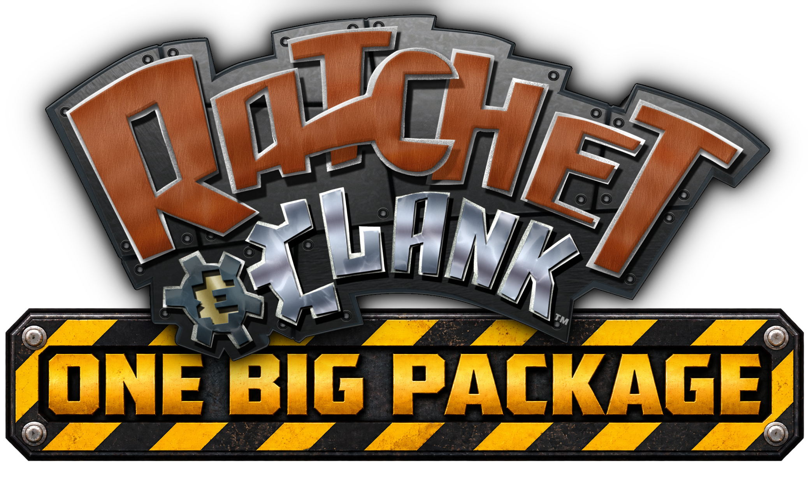

<p align="center">
  
</p>

# One Big Package

One Big Package (OBP) is a Godot 4 and C# project to combine the original PlayStation 2 games *Ratchet & Clank*, *Going Commando* and *Up Your Arsenal* into one game.

The first step is reconstructing the original games' levels and systems from user-supplied discs. These are the building blocks for the combined game, rather than three separate campaigns being the final goal.

## Goals

The long-term aim is to let content and progression cross the boundaries between the three games. For example:

- **One connected galaxy:** Travel between planets from all three games on a shared galaxy map, with one save for equipment, bolts, collectibles and mission progress.
- **Equipment across games:** Keep weapons from the whole trilogy, use later gadgets or Clank abilities on earlier planets, and work out how upgrades and vendors fit together.
- **Reasons to revisit planets:** Return to familiar locations with new equipment, routes, characters and missions.
- **Combined encounters:** Mix enemies from different games, including arena challenges that draw on the full weapon collection and enemy roster.

The original mechanics and encounters are being recovered first, so they can be preserved or deliberately adapted. The final campaign structure, balance and progression have not been decided yet.

**OBP is still in development and is not a complete playable trilogy.**

## Current status

- **Ratchet & Clank (2002):** Most active gameplay work. Player movement, weapons, enemies, pickups, campaign state and other systems are implemented to varying degrees.
- **Going Commando (2003):** World loading, presentation and some game systems are implemented. Gameplay is incomplete.
- **Up Your Arsenal (2004):** World loading, presentation and some game systems are implemented. Gameplay is incomplete.

See [issues](https://github.com/je55pr/one-big-package/issues) and [pull requests](https://github.com/je55pr/one-big-package/pulls) for current work.

R&C1 Quick Select includes the GC Lancer and UYA Shock Cannon by default alongside
owned R&C1 weapons. Their shared assets prepare during Game Sources setup and
stay loaded across level changes. The original game sources are required; see
[cross-game weapon controls and limits](docs/FUSION_WEAPONS_TESTING.md).

## Getting started

On Windows, with the .NET 8 SDK installed, run from the repository root:

```powershell
./tools/bootstrap-dev.ps1
./tools/play.ps1
```

The bootstrap script downloads the project's pinned Godot .NET version and builds the project. If no game source is configured, the app opens the Game Sources screen.

OBP requires your own supported retail game files to load original levels. **No disc images, game assets or executables are included in this repository.**

## Testing

```powershell
# Build and unit tests
./tools/test.ps1 -Configuration Release

# Tests that require locally supplied game data
./tools/test-retail.ps1
```

Pull requests also run .NET tests, CodeQL analysis and an asset-free Godot startup test. Some R&C1 gameplay can be recorded and replayed; see [movement and replay documentation](docs/MOVEMENT_REPRO_STATES.md).

## Project layout

| Directory | Contents |
| --- | --- |
| `src/OBP.IO`, `src/OBP.PS2` | Disc access and PS2 file formats |
| `src/OBP.RAC1`, `src/OBP.RAC2`, `src/OBP.RAC3` | Game-specific formats and behaviour |
| `src/OBP.Runtime` | Engine-independent runtime |
| `src/OBP.Godot`, `game/` | Godot integration and application |
| `research/` | Reverse-engineering notes and evidence |
| `tests/`, `tools/` | Tests and development scripts |

## Documentation

- [Architecture](docs/ARCHITECTURE.md)
- [Project vision](docs/PROJECT_VISION.md)
- [Research index](research/README.md)
- [Retail testing](docs/RETAIL_TESTING.md)
- [Development guidelines](AGENTS.md)
- [External source policy](research/EXTERNAL_SOURCE_POLICY.md)

Development uses feature branches and pull requests into the protected `dev` branch. Merges are manual.

This is an unofficial fan project and is not affiliated with Sony Interactive Entertainment or Insomniac Games.
