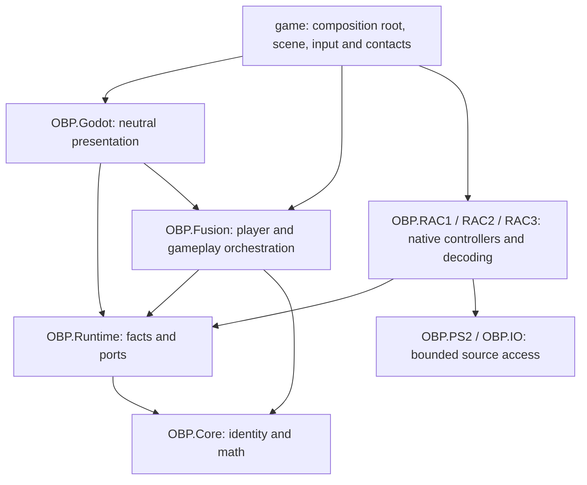

# Source, player, world and actor contract (#265)

This is the shared contract for the #264 reconciliation gate. It records OBP
design, not recovered native equivalence. Version 1 defines small executable
ports and a planning seam before the dependent host refactors.

## Ownership

| Owner | Authority | May not choose |
|---|---|---|
| Source (`OBP.RAC1/2/3`) | Decoders, native controllers/formulas, source campaign state, authored context and evidence | Another source's rules or the ordinary OBP player configuration |
| Persistent player session (`OBP.Fusion`, Runtime facts/ports) | Selected avatar, independent movement/animation profiles and clocks, loadout, health policy, resources, input/camera/UI/audio policy ids | Its defaults from the current planet's origin |
| World lease | Destination/provenance, geometry, environment, authored entry facts, actors and scene-local lifetimes | Player identity, availability of a player-global service, or a replacement inventory |
| Actor | Its own source/build/asset, native controller/context, instance identity, lifecycle and admitted capabilities | Native semantics from the world's source or an equal number from another game |
| Godot host | Scenes, rendering/audio, input, physics/contact observations and composition-root wiring | Native formulas or cross-game gameplay policy |

**Destination chooses the world, not Ratchet.** Two worlds can produce different
contacts, water state, mission/taxi context or authored starts. Changing only
`world.Game`/`destination.Game` cannot change avatar/provider, animation clock,
movement/collision profile, attack routing, health, HUD, pause, Quick Select or
player/equipment audio. Capabilities follow selected profiles, genuine loaded
content and explicit context admission; neither planet membership nor a label
proves that a mechanic is implemented.

The initial ordinary policy is genuine R&C1 Ratchet with its admitted native
animation/movement controllers at 60 native ticks per second on every world.
This is an explicit OBP choice. Future appearances may vary independently from
movement when measured pose/controller compatibility admits them. GC/UYA skin
support is not implied by a compatible 111-joint skeleton. Required source/assets
missing means an actionable failure, never a silent capsule or mislabeled skin.
A capsule remains an explicitly selected diagnostic, outside ordinary admission.

## Dependencies

RAC modules do not reference each other or Fusion. Fusion does not reference RAC,
IO/PS2, Godot or the application. Runtime references Core only. Source-native
implementations of Runtime ports remain source-owned; the composition root wires
them into Fusion. A host adapter may connect an existing `IObpWorldProvider` or
authored generator to the entry port. It must not acquire gameplay decisions.
Do not move a native movement/damage/AI formula into Fusion to satisfy this graph.

## Version-1 ports and identities

| Contract | Location | Consumer / owner |
|---|---|---|
| `PlayerSessionConfiguration`, `SourceProfileKey`, `PlayerServiceBindings` | Runtime/Player/PlayerSessionContracts.cs | #266 session; #268 avatar/clock; #269 movement/input/camera; #270 health; #259 UI; #272 audio |
| `PlayerSessionSnapshot`, `PlayerLoadoutSnapshot`, `PlayerHealthSnapshot` | Same | One session owner; #255 expands equipment state, #270 resolves health; #273/#274 define durable save/replay envelopes |
| `IObpPlayerSession` | Same | #266 implements in Fusion; all world transitions retain the same owner |
| `ActorInstanceKey`, `ActorRegistration`, `ActorCapabilityRegistration` | Fusion/ActorRegistration.cs | #256 registers source-native actors and bridges existing weapon contacts |
| `WorldEntryRequest`, `PreparedWorldEntry`, `WorldEntryPlan`, `IWorldEntrySource`, `IWorldEntryHost` | Fusion/WorldEntryContracts.cs | #267 world lifecycle; native provider and authored Lab use one pipeline |

The outer snapshot, world request and actor registration each carry version 1;
unknown versions fail closed. Add compatible observations with explicit defaults;
breaking meaning/identity changes require a new version and migration. These are
in-memory boundary contracts, not a promised save-file or replay wire format.

Reuse `PlayerAvatarIdentity` (source/build/avatar/model), `SourceWeaponKey`
(game/item), `WeaponTargetKey` (game/class/contact instance) and `WeaponShotKey`.
Do not create a rival equipment key/catalog or project foreign native ids through
an R&C1 enum. Controller profiles have independent source/build/profile identity;
OBP policy bindings use explicit versioned registry ids, not source-local numbers.
The catalog resolves actual implementation/source/asset/context availability.
An id in configuration is a desired selection, not proof of runtime usability.
Weapon keys retain their existing game/item shape; the catalog's source/build
registrations and later save/replay manifest pin the admitted weapon assets.
Do not introduce a competing build-qualified weapon key in a host partial.

`ActorInstanceKey` adds world-instance id and lease generation to the existing
source-qualified target key. Allocate contact instance indices uniquely within a
source/lease, including cloned actors; original authored placement identity stays
in `ActorRegistration.Source`. Duplicate keys, source mismatches and old lease
registrations are rejected. The adapter id and optional source-backed context id
are explicit. #256 owns concrete spawn/context validation and native state.
Ready/missing source/missing asset/unimplemented/missing context remain distinct;
every unavailable capability explains why. Registration does not implement AI.

#256 and #270 must route actor attacks with this registered attacker identity,
lease generation and an attack sequence to the selected player's health policy.
Keep original amount/flags/owner evidence, reject stale or duplicate intents, and
label conversion/admission as OBP policy. Reuse `WeaponDamageIntent` for weapon
contacts. This PR does not invent a universal native damage payload or balance rule.

## Player snapshots and lifetime

`Capture` returns frozen copies of configuration, selections, resolved health and
resource facts. `Restore` is an explicit session operation, never a side effect
of destination selection. Player id stays stable; session generation changes on
explicit reset/restore policy, independently from each world lease generation.
No scene object, local path or retail payload belongs in a snapshot.

Selection is distinct from hand ownership: a selected gun can remain selected
while the wrench owns the hand after a wrench attack. Quick Select contains
source-qualified slot assignments, including empty slots. #255 owns the single
catalog plus native equipment/ammo/gadget state contributors under this session;
the selection snapshot is not a complete inventory, unlock system or weapon VM.
Do not make a second session/campaign inventory to fill those future fields.

Keep player health/currency facts separate from HUD projection and original
campaign balances. #270 owns their selected OBP policies; no final economy or
cross-source damage conversion is implied by these numeric facts. Source-owned
campaign saves and opaque native state remain behind their existing adapters.

World-local physics position/velocity/contact anchors, blend transients, active
projectiles, sounds, effects and enemy registrations belong to the current lease.
World exit retires them and their subscriptions. The persistent session, desired
loadout, avatar/profile and player-global resources survive. Re-entry receives
new source/authored entry facts; it does not resurrect old collision or audio.

## One world-entry path

1. Caller supplies a real destination id, world-instance/generation and explicit
   ordinary/parity/diagnostic mode. A custom world never impersonates `rac1:LEVEL0`.
2. Capture the stable player session and resolve its selected avatar provider and
   pinned build independently of the world. `WorldEntryPlanning.Prepare` enforces
   this today; it never mutates/restores the session or owns a scene.
3. `IWorldEntrySource.Prepare` stages the native provider or authored generator,
   entry point and actor descriptions. Native campaign/checkpoint adapters own
   source-authored entry semantics; geometry/contact facts remain world-local.
4. #267 validates assets, scene/contact staging and required adapters before the
   destructive boundary. A failure leaves the existing player/session available.
5. One `IWorldEntryHost.Activate` implementation commits the prepared plan, builds
   the player scene from session configuration, connects world actors/environment
   and presents the common HUD/menu. Dispose the old world lease and subscriptions
   at the controlled boundary; never dispose the persistent player owner.

The planner is a tested contract seam. Actual host lifecycle migration, source
attachment/asset loading, fixed-rate ticking and atomic scene cleanup are still
#266/#267/#268 work. Do not claim the current ordinary host already uses these ports.

## CI guard and retained parity flow

`SourceNeutralHostArchitectureTests` binds C# symbols with Roslyn: it follows
aliases, conditional access and property patterns for `RuntimeWorld.Game` and
`ObpDestination.Game`, and detects the legacy `UseRac1Gameplay` gate. Asset/actor
`ObpSourceRef.Game`, comments and string labels are not world selections.
It scans ordinary game scripts, Godot adapters and Fusion. Explicit staged smoke
implementations under `game/diagnostics` remain the separate diagnostic boundary.

`tests/OBP.Tests/host-ownership-policy.json` lists individual members with reasons:

- `adapter`: narrow source import, environment, campaign, provenance or diagnostic
  read with a fixed token fingerprint. It cannot use the legacy player flag or
  select player services. Any code change fails until its source-owned purpose,
  focused regression and fingerprint update are reviewed together. Legitimate
  water/campaign/environment updates remain possible through that explicit update.
- `migration`: existing player-global coupling, a follow-up owner and a fixed
  hash of C# tokens. Comments/formatting do not affect it. Changing/expanding a
  retained coupling fails; migration removes its dependency and ledger entry.

There are no blanket source-file or RAC-prefix exemptions. New ownership sites
fail with `OBP001`; stale entries also fail. Tests inject an erroneous avatar
lookup into the actual host and verify the focused failure, alongside alias,
pattern, menu/action and legitimate source-provenance cases. Assembly tests also
reject qualified native references, not only `using` directives.

Both exception kinds fingerprint the entire member's tokens, ignoring comments,
formatting and checkout line endings. An approved adapter cannot silently add a
player mutation through a call outside the known-sink heuristic: the regression
injects the real `OnRac1WeaponSelectionRequested(Blaster)` call into `WorldOptions`
and verifies rejection. Migration entries must still be removed with their
coupling, not rebaselined to expand it. Adapter fingerprint updates document
reviewed source-world work; they are not permission for player-global behavior.

Existing original-game mission, water, taxi, checkpoint and native fidelity
fixtures remain operational. They establish original-world/source claims, not
ordinary fusion behavior. #266/#267 introduce explicit retail-parity session/
entry configuration; the ordinary path must never select that mode from origin.
Preserve the retail R&C1 UI, campaign saves and source controllers in that flow.
#274 migrates current R&C1-only replay admission; #275 keeps both fidelity and
cross-world integration evidence. Do not weaken native tests to hide fusion drift.

## Follow-up write ownership

| Owner | Primary write scope | Boundary / sequencing |
|---|---|---|
| #266 | Fusion player-session implementation; `OBPGame.TeardownWorld`, Rac1Lifecycle player resets | One persistent state owner; agree lease hooks with #267 before either edits shared lifecycle |
| #267 | `OBPGame.Destinations`, `OBPGame.FusionLab`, `WorldHost`, world-entry portion of `SpawnPlayer` | Extract shared entry/spawn hooks first; retain campaign/environment adapters |
| #268 | `OBPGame.PlayerAvatar`, avatar pose/physics-clock subscriptions; animation update/reset in `PlayerHost.Animation` | Consume session-selected provider/profile; coordinate same-file edits with #269 |
| #269 | `PlayerHost` movement/input/collider/camera, RawGamepadInput, primary-action routing | Consume explicit profiles/capabilities; #267 owns entry and #268 owns pose clocks |
| #255 | Catalog/loadout and `FusionWeaponSession`; selection/session portions of `OBPGame.FusionWeapons` and Quick Select | No second inventory; separate selection from held/effect presentation before #271 edits |
| #270 | Player health policy, incoming attack adapter and HUD projection; `RefreshRac1HudState` migration | #256 emits registered actor intent; native victim rules remain source-owned |
| #271 / #272 | Held models/attachments/effects / player-weapon audio partials | Consume selected source-qualified equipment/profile; no destination grants |
| #259 | Ordinary OBP pause UI and Quick Select presentation; `OBPGame.ControllerSettings` wiring | Consume #255/#270 projections; retain retail menu as explicit parity adapter |
| #256 | Actor adapters, target/contact registry and mixed combat | Consume the one world lease/player owner, never a per-source player |
| #273 / #274 / #275 | Durable save/profile / cross-world replay and bug capture / final route acceptance | Extend versioned session boundaries after foundations; final gate is Veldin→Oozla→UYA Veldin→Lab→Veldin |

These are bounded PRs after this contract, not permission to start all refactors
inside #265. Where a listed partial has two owners, extract the agreed seam or
sequence commits before parallel editing. Keep source-native formulas in RAC;
the goal is consistent orchestration, not a new generic retail simulation.
