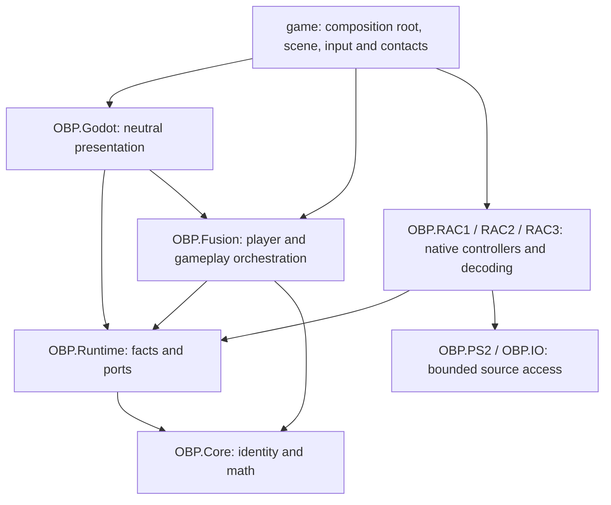

# Source, player, world and actor contract (#265)

This is the shared contract for the #264 reconciliation gate. It records OBP
design, not recovered native equivalence. Version 1 defines executable ports;
#266/#267 implement the persistent session and shared native/custom lifecycle.

## Ownership

| Owner | Authority | May not choose |
|---|---|---|
| Source (`OBP.RAC1/2/3`) | Decoders, native controllers/formulas, source campaign state, authored context and evidence | Another source's rules or the ordinary OBP player configuration |
| Persistent player session (`OBP.Fusion`, Runtime facts/ports) | Selected avatar, independent movement/animation profiles and clocks, loadout, health policy, resources, input/camera/UI/audio policy ids | Its defaults from the current planet's origin |
| World lease | Destination/provenance, geometry, environment, authored entry facts, actors and scene-local lifetimes | Player identity, availability of a player-global service, or a replacement inventory |
| Actor | Its own source/build/asset, native controller/context, instance identity, lifecycle and admitted capabilities | Native semantics from the world's source or an equal number from another game |
| Godot host | Scenes, rendering/audio, input, physics/contact observations and composition-root wiring | Native formulas or cross-game gameplay policy |

**Destination chooses the world, not Ratchet.** Two worlds can produce different
contacts, water state, mission/taxi context or authored starts. Changing only
`world.Game`/`destination.Game` cannot change avatar/provider, animation clock,
movement/collision profile, attack routing, health, HUD, pause, Quick Select or
player/equipment audio. Capabilities follow selected profiles, genuine loaded
content and explicit context admission; neither planet membership nor a label
proves that a mechanic is implemented.

The initial ordinary policy is genuine R&C1 Ratchet with its admitted native
animation/movement controllers at 60 native ticks per second on every world.
This is an explicit OBP choice. Future appearances may vary independently from
movement when measured pose/controller compatibility admits them. GC/UYA skin
support is not implied by a compatible 111-joint skeleton. Required source/assets
missing means an actionable failure, never a silent capsule or mislabeled skin.
A capsule remains an explicitly selected diagnostic, outside ordinary admission.

## Dependencies

RAC modules do not reference each other or Fusion. Fusion does not reference RAC,
IO/PS2, Godot or the application. Runtime references Core only. Source-native
implementations of Runtime ports remain source-owned; the composition root wires
them into Fusion. A host adapter may connect an existing `IObpWorldProvider` or
authored generator to the entry port. It must not acquire gameplay decisions.
Do not move a native movement/damage/AI formula into Fusion to satisfy this graph.

## Version-1 ports and identities

| Contract | Location | Consumer / owner |
|---|---|---|
| `PlayerSessionConfiguration`, `SourceProfileKey`, `PlayerServiceBindings` | Runtime/Player/PlayerSessionContracts.cs | #266 session; #268 avatar/clock; #269 movement/input/camera; #270 health; #259 UI; #272 audio |
| `PlayerSessionSnapshot`, `PlayerLoadoutSnapshot`, `PlayerHealthSnapshot` | Same | One session owner; #255 expands equipment state, #270 resolves health; #273/#274 define durable save/replay envelopes |
| `IObpPlayerSession` | Same | #266 implements in Fusion; all world transitions retain the same owner |
| `ActorInstanceKey`, `ActorRegistration`, `ActorCapabilityRegistration` | Fusion/ActorRegistration.cs | #256 registers source-native actors and bridges existing weapon contacts |
| `WorldEntryRequest`, `PreparedWorldEntry`, `WorldEntryPlan`, `IWorldEntrySource`, `IWorldEntryHost` | Fusion/WorldEntryContracts.cs | #267 world lifecycle; native provider and authored Lab use one pipeline |

The outer snapshot, world request and actor registration each carry version 1;
unknown versions fail closed. Add compatible observations with explicit defaults;
breaking meaning/identity changes require a new version and migration. These are
in-memory boundary contracts, not a promised save-file or replay wire format.

Reuse `PlayerAvatarIdentity` (source/build/avatar/model), `SourceWeaponKey`
(game/item), `WeaponTargetKey` (game/class/contact instance) and `WeaponShotKey`.
Do not create a rival equipment key/catalog or project foreign native ids through
an R&C1 enum. Controller profiles have independent source/build/profile identity;
OBP policy bindings use explicit versioned registry ids, not source-local numbers.
The catalog resolves actual implementation/source/asset/context availability.
An id in configuration is a desired selection, not proof of runtime usability.
Weapon keys retain their existing game/item shape; the catalog's source/build
registrations and later save/replay manifest pin the admitted weapon assets.
Do not introduce a competing build-qualified weapon key in a host partial.

`ActorInstanceKey` adds world-instance id and lease generation to the existing
source-qualified target key. Allocate contact instance indices uniquely within a
source/lease, including cloned actors; original authored placement identity stays
in `ActorRegistration.Source`. Duplicate keys, source mismatches and old lease
registrations are rejected. The adapter id and optional source-backed context id
are explicit. #256 owns concrete spawn/context validation and native state.
Ready/missing source/missing asset/unimplemented/missing context remain distinct;
every unavailable capability explains why. Registration does not implement AI.

#256 and #270 must route actor attacks with this registered attacker identity,
lease generation and an attack sequence to the selected player's health policy.
Keep original amount/flags/owner evidence, reject stale or duplicate intents, and
label conversion/admission as OBP policy. Reuse `WeaponDamageIntent` for weapon
contacts. This PR does not invent a universal native damage payload or balance rule.

## Player snapshots and lifetime

`Capture` returns frozen copies of configuration, selections, resolved health and
resource facts. `Restore` is an explicit session operation, never a side effect
of destination selection. Player id stays stable; session generation changes on
explicit reset/restore policy, independently from each world lease generation.
No scene object, local path or retail payload belongs in a snapshot.

`ObpPlayerSession` owns that lifetime. The host supplies a native-state adapter
whose immutable component preserves the admitted inventory, ammo, hand ownership,
health and wallet controllers. Fusion copies the outer observations and never
decodes native state. The ordinary player imports initial campaign equipment
once; its controllers then live independently from the source campaign. The
camera/input preferences adapter captures current menu choices and applies an
explicit restore without rewriting device settings. Device calibration remains
host/device state. Restore/configuration changes invalidate staged generations;
destination changes never call Restore. These snapshots are in-memory state,
not the durable source campaign format or the future OBP save format.

Selection is distinct from hand ownership: a selected gun can remain selected
while the wrench owns the hand after a wrench attack. Quick Select contains
source-qualified slot assignments, including empty slots. #255 owns the single
catalog plus native equipment/ammo/gadget state contributors under this session;
the selection snapshot is not a complete inventory, unlock system or weapon VM.
Do not make a second session/campaign inventory to fill those future fields.

Keep player health/currency facts separate from HUD projection and original
campaign balances. #270 owns their selected OBP policies; no final economy or
cross-source damage conversion is implied by these numeric facts. Source-owned
campaign saves and opaque native state remain behind their existing adapters.

World-local physics position/velocity/contact anchors, blend transients, active
projectiles, sounds, effects and enemy registrations belong to the current lease.
World exit retires them and their subscriptions. The persistent session, desired
loadout, avatar/profile and player-global resources survive. Re-entry receives
new source/authored entry facts; it does not resurrect old collision or audio.

## One world-entry path

1. Caller supplies a real destination id, world-instance/generation and explicit
   ordinary/parity/diagnostic mode. A custom world never impersonates `rac1:LEVEL0`.
2. Capture the stable player session and resolve its selected avatar provider and
   pinned build independently of the world. `WorldEntryPlanning.Prepare` enforces
   this today; it never mutates/restores the session or owns a scene.
3. `IWorldEntrySource.Prepare` stages the native provider or authored generator,
   entry point and actor descriptions. Native campaign/checkpoint adapters own
   source-authored entry semantics; geometry/contact facts remain world-local.
4. Stage selected avatar/wrench assets and world scene/collision before the
   destructive boundary. Reject missing or changed sources before unloading the
   live world. This preparation failure leaves its player scene available.
5. One `IWorldEntryHost.Activate` implementation commits the prepared plan, builds
   the player scene from session configuration, connects world actors/environment
   and presents the common HUD/menu. Dispose the old world lease and subscriptions
   at the controlled boundary; never dispose the persistent player owner.

`WorldEntrySession` and `OBPGame.WorldEntry` now implement this path for native
providers and the authored Lab. The lease owns one `WorldHost` and ephemeral
`PlayerHost`; teardown retires old views, contacts, effects, audio and subscriptions
while retaining player controllers, selections, resources and preferences.
The Lab keeps `obp:fusion-lab` and no native `_activeDestination`. Authored starts,
R&C1 checkpoints/travel and source environment/actor hooks stay narrow adapters.
An unexpected failure during destructive activation cleans partial scene resources
and returns to selection with the session retained; it does not promise scene
rollback after activation begins. The selected profiles and service registrations
below complete the #268/#269 bridge; #256 still owns mixed actor registration.
This does not make every weapon effect, source attack or UI policy available.

## Selected controls, animation, health and equipment

`PlayerProfileRegistry` admits a `PlayerControlProfile`, a measured avatar/animation
pair, the fixed native clock and a registered service composition before unloading
the current world. The genuine R&C1 Ratchet is the ordinary default in all four
destinations. Missing profiles, incompatible poses, unavailable sources and clock
mismatches fail visibly; no ordinary capsule or generic animation fallback is
allowed. The explicit diagnostic capsule has its own registration.

Movement, contact, traversal and camera adapter IDs are independent from action
and interface capabilities. `UseRac1Gameplay` has been removed from production.
The registered R&C1 collision envelope and native movement/camera laws are reused
by deliberate OBP choice, not attributed to GC/UYA. Imported collision material
bytes carry their own source/build identity. Foreign or unclassified bytes remain
physical geometry without being decoded as R&C1 water, ice or ledge flags.
Input uses one normalized boundary, including menu masks and controller reconnect
suppression. Player physics owns animation and health updates; rendering cannot
advance the selected 60Hz clock. Re-entry retires subscriptions and the old
collision object before the replacement player's placement ray runs.

`PlayerSessionNativeState.Life` is the persistent `PlayerHealthSession`; its victim
port wraps the existing R&C1 nanotech controller, not a second health counter.
Policy `obp/rac1-derived-health/v1` deliberately chooses four capacity/respawn units,
the recovered 77-native-tick protection, integer 1:1 admitted damage conversion and
fresh life at the current world's entry while retaining wallet, ammo and loadout.
Capacity/progression upgrades and a final economy remain future OBP choices.
The named native parity path retains original R&C1/GC sessions and checkpoint rules.

Incoming source adapters validate their native descriptors before submitting an
attack qualified by `ActorInstanceKey`, build, adapter, descriptor and sequence.
The shared victim rejects wrong builds, stale leases, unknown/dead actors, invalid
amounts, unsupported conversions and duplicate sequences. Actor life comes from
the native controller, not model visibility. Existing R&C1 descriptors and the
bounded GC Aranos MSR I attack are admitted; unrecovered UYA attacks are not invented.
Native R&C1 pickups credit the same persistent wallet/health. GC's source owner
admits each collected physical class-500 bolt once, then an explicit 1:1 OBP
conversion credits the shared wallet once per source-qualified pickup receipt.
Native deferred values stay in their source session. Campaign saves are separate.
The common HUD projects health/life, currency, selected weapon/ammo, and admitted
water/context facts everywhere; absent source context intentionally has no meter.

`PlayerEquipmentRegistrations.Catalog` exposes neutral `EquipmentCatalogEntry`
records. These include stable source/build identity, category/name, ownership,
implementation, model/icon readiness, selection/actual hand, ammo and a specific
source/build/model/context failure reason. Existing `SourceWeaponKey` and
`PlayerAvatarIdentity` remain the item and appearance identities. It registers the
16 implemented R&C1 weapons including the wrench, GC Lancer, UYA Shock Cannon,
five supported R&C1 movement gadgets, and the genuine R&C1 avatar. GC/UYA avatars
and R&C1 boots remain explicitly unimplemented. Metal Detector's bounded source
digging prototype is listed as unsupported until its genuine handheld/common-action
adapter exists; the old native diagnostic shortcut is not advertised as that port.
Gadget model status `NotRequired`
describes the recovered movement capability, not a reconstructed backpack mesh.

The ordinary `DevelopmentAvailable` policy grants implemented, attached-source
items only to the independent player inventory, once; re-entry does not refill
ammo. Explicit `RetailCampaign` policy retains native ownership restrictions.
`PlayerEquipmentAssignments` owns eight source-qualified Quick Select slots and
enabled gadgets; one backpack conflict group prevents simultaneous packs. These
assignments are captured with version 2 of the native player component (the neutral
session envelope remains version 1). Source loss retains
the desired weapon/slots, falls back to the wrench and exposes the reason. Restoring
the source allows the existing action/equip pipeline to draw the desired item.
The deterministic configuration hash includes registrations, source builds,
loadout policy, appearance, desired weapon, slots and enabled gadgets, without paths
or retail payloads; it is an admission identity, not the final replay/save format.

The future #259 UI consumes `ReadPlayerEquipment`, `SelectPlayerEquipment`,
`AssignPlayerQuickSelect`, `SetPlayerGadgetEnabled` and
`PlayerEquipmentConfigurationIdentity`. The existing Quick Select consumes this
read model now; overflow pages follow the eight assigned slots. This ticket does
not rebuild pause-menu visuals. Native weapon effect/contact adapters still owned
by #271 report `ContextBlocked` where unavailable; #272 retains audio migration.

`tools/player-capabilities-smoke.ps1 -Rendered` compares 240-tick scripted movement,
camera, sequences, pose hashes, hand attachments and native elapsed time in
Veldin, Oozla, UYA Veldin and Fusion Lab, then re-enters Veldin. Its explicit common
contact deck removes legitimate geometry differences from that comparison. Two
fresh processes at 30/120 rendering FPS must produce identical payload-free traces.
It also exercises menu masks, wrench ownership, catalog/source recovery, a live
source-generated GC attack, shared HUD/death/respawn and continuous resources.
The existing source-native parity/replay fixtures remain separate authority gates.

## CI guard and retained parity flow

`SourceNeutralHostArchitectureTests` binds C# symbols with Roslyn: it follows
aliases, conditional access and property patterns for `RuntimeWorld.Game` and
`ObpDestination.Game`, and detects the legacy `UseRac1Gameplay` gate. Asset/actor
`ObpSourceRef.Game`, comments and string labels are not world selections.
It scans ordinary game scripts, Godot adapters and Fusion. Explicit staged smoke
implementations under `game/diagnostics` remain the separate diagnostic boundary.

`tests/OBP.Tests/host-ownership-policy.json` lists individual members with reasons:

- `adapter`: narrow source import, environment, campaign, provenance or diagnostic
  read with a fixed token fingerprint. It cannot use the legacy player flag or
  select player services. Any code change fails until its source-owned purpose,
  focused regression and fingerprint update are reviewed together. Legitimate
  water/campaign/environment updates remain possible through that explicit update.
- `migration`: existing player-global coupling, a follow-up owner and a fixed
  hash of C# tokens. Comments/formatting do not affect it. Changing/expanding a
  retained coupling fails; migration removes its dependency and ledger entry.

There are no blanket source-file or RAC-prefix exemptions. New ownership sites
fail with `OBP001`; stale entries also fail. Tests inject an erroneous avatar
lookup into the actual host and verify the focused failure, alongside alias,
pattern, menu/action and legitimate source-provenance cases. Assembly tests also
reject qualified native references, not only `using` directives.

Both exception kinds fingerprint the entire member's tokens, ignoring comments,
formatting and checkout line endings. An approved adapter cannot silently add a
player mutation through a call outside the known-sink heuristic: the regression
injects the real `OnRac1WeaponSelectionRequested(Blaster)` call into `WorldOptions`
and verifies rejection. Migration entries must still be removed with their
coupling, not rebaselined to expand it. Adapter fingerprint updates document
reviewed source-world work; they are not permission for player-global behavior.

Existing original-game mission, water, taxi, checkpoint and native fidelity
fixtures remain operational. They establish original-world/source claims, not
ordinary fusion behavior. `--retail-parity` selects the retained source campaign
flow. Existing named native smoke, campaign-persistence and R&C1 replay options
also explicitly request that mode; ordinary entry never derives it from origin.
`--diagnostic-player` explicitly selects the asset-free capsule. Ordinary entry
requires the selected genuine R&C1 avatar source on every planet and in the Lab.
Preserve the retail R&C1 UI, campaign saves and source controllers in that flow.
#274 migrates current R&C1-only replay admission; #275 keeps both fidelity and
cross-world integration evidence. Do not weaken native tests to hide fusion drift.

## Follow-up write ownership

| Owner | Primary write scope | Boundary / sequencing |
|---|---|---|
| #266 | Fusion player-session implementation; `OBPGame.TeardownWorld`, Rac1Lifecycle player resets | One persistent state owner; agree lease hooks with #267 before either edits shared lifecycle |
| #267 | `OBPGame.Destinations`, `OBPGame.FusionLab`, `WorldHost`, world-entry portion of `SpawnPlayer` | Extract shared entry/spawn hooks first; retain campaign/environment adapters |
| #268 | `OBPGame.PlayerAvatar`, avatar pose/physics-clock subscriptions; animation update/reset in `PlayerHost.Animation` | Consume session-selected provider/profile; coordinate same-file edits with #269 |
| #269 | `PlayerHost` movement/input/collider/camera, RawGamepadInput, primary-action routing | Consume explicit profiles/capabilities; #267 owns entry and #268 owns pose clocks |
| #255 | Catalog/loadout and `FusionWeaponSession`; selection/session portions of `OBPGame.FusionWeapons` and Quick Select | No second inventory; separate selection from held/effect presentation before #271 edits |
| #270 | Player health policy, incoming attack adapter and HUD projection; `RefreshRac1HudState` migration | #256 emits registered actor intent; native victim rules remain source-owned |
| #271 / #272 | Held models/attachments/effects / player-weapon audio partials | Consume selected source-qualified equipment/profile; no destination grants |
| #259 | Ordinary OBP pause UI and Quick Select presentation; `OBPGame.ControllerSettings` wiring | Consume #255/#270 projections; retain retail menu as explicit parity adapter |
| #256 | Actor adapters, target/contact registry and mixed combat | Consume the one world lease/player owner, never a per-source player |
| #273 / #274 / #275 | Durable save/profile / cross-world replay and bug capture / final route acceptance | Extend versioned session boundaries after foundations; final gate is Veldin→Oozla→UYA Veldin→Lab→Veldin |

Later stages remain separate work. Where a listed partial has two owners, extract the agreed seam or
sequence commits before parallel editing. Keep source-native formulas in RAC;
the goal is consistent orchestration, not a new generic retail simulation.
