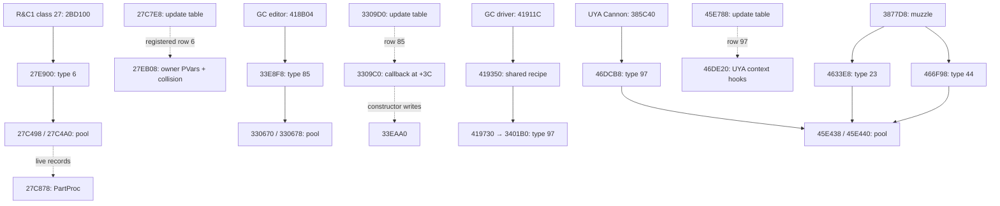

# Native effects reference audit (#281)

This is milestone 1 of [#280](https://github.com/je55pr/one-big-package/issues/280).
It records an investigation and a proposed boundary, not an implemented engine.
Milestones #282–#285 remain separate. No production, shared host, session or
Runtime contract changes are part of this audit.

Implementation follow-ups: [R&C1 #282](RAC1_TYPE6_EMITTER.md),
[GC Museum #283](RAC2_MUSEUM_PARTICLES.md) and [UYA #284](RAC3_PARTICLES.md). This catalogue retains its audit
baseline below; the follow-ups record implemented coverage and refined findings.

Survey date: 2026-10-25. OBP baseline: `dev`
`77821e1377c42f8e3344d1dd00c1429894696293`. Recheck host locations when the
pending structural changes land; the native identities below do not depend on
those locations.

The shortest valid implementation path is R&C1's class-27/type-6 owner-driven
emitter, followed by GC's Museum type-85 constructor/callback and its separate
type-97 family. UYA has concrete charge and muzzle particle call chains in
addition to the already working beam. A common pool shape is evidence for
comparison, not permission to substitute one game's updates for another's.

## Evidence and authority

- **Verified**: locally checked retail structure, instruction/call edge or hash;
  the three new [retail witness tests](../tests/OBP.Tests/EffectsReferenceAuditRetailTests.cs)
  reproduce those checks. This does not mean a recovered update was executed.
- **Inferred**: interpretation from upstream code/disassembly, call context or
  matching structure, with the remaining experiment stated.
- **Missing**: OBP has no admitted implementation or the necessary observation
  has not been made.
- **Source inspected**: an upstream implementation/claim was read at the pinned
  revision. It is not a second independent retail oracle.

| Source | OBP authority | Audited native program |
|---|---|---|
| R&C1 | `rac1-ntscu-original`, SCUS-97199 | Novalis LEVEL1; overlay SHA-256 `81673b8dcf5930c7313a7c83d0f76e5e1948691dc09af63dd8c8f6a04f9a72ae` |
| GC | `rac2-ntscu-v1.01`, SCUS-97268 original v1.01 | File LEVEL21.WAD, engine level 30, Insomniac Museum; overlay `b46e44c26195efd160b1bc62910cf22e1b1fe3eb46944f5926a9f2b7879e45b6` |
| UYA | `rac3-ntscu-original`, SCUS-97353 | TABLE1/Veldin; overlay `093fb8641cb2bf48073793f6cfac726cb7321654d285b848658f3e957df1dcec` |

Whole-disc identities remain in `Rac1Authority`, `Rac2Authority`,
`Rac3Authority` and [the authority manifests](manifests/). Every address
below is qualified by this table or by an explicitly named boot/upstream level.
PAL addresses, GC Greatest Hits, other overlays and same-valued type IDs are
not silently substituted.

[Fixtures and reproduction](EFFECT_SYSTEMS_FIXTURES.md) distinguish the checks
run here from the still-required native execution and GPU observations.

## Pinned sources and licence ledger

These are the inspected revisions, not claims about later upstream heads.
Links below resolve to those exact revisions.

| Reference | Revision | Recorded terms and allowed use in this milestone |
|---|---|---|
| [ReRAC][rr-root] | `7d0d031a4f293c1214d01de90918fe3ec234b673` | [ISC][rr-license], copyright 2026 ReRAC contributors. A future adaptation must retain its copyright and permission notice. This audit imports no Rust or shader implementation. |
| [OpenRAC][or-root] | `415e1added5b7c879f87875604d97c7d7237734a` | [Path-specific ledger][or-license]: top-level docs/port are GPL-3.0-or-later; `effects.h` explicitly says so. Some nested game trees have different terms. Reading facts does not authorise copying/translation into OBP. |
| [GC decomp][gc-root] | `dcfcd1f90746f3fbba715825d25bf19e88bf875c` | [Project licence][gc-license], [README/terms][gc-readme] and [LEGAL][gc-legal]: project-authored work GPL-3.0; reconstructed `src/` game code explicitly excluded, with no licence granted. “GPL GC decomp” is insufficient provenance for importing a function. |
| [UYA decomp][uya-root] | `fc118a0b7442665a2b181055dc352ce5d117c41b` | [Split licence][uya-license]: tooling/docs/headers/tables GPL-3.0; reconstructed game `src/` is explicitly unlicensed; GCC runtime has its separate exception. Do not import its C or assembly. |

This applies the existing [external-source policy](EXTERNAL_SOURCE_POLICY.md)
to these references. No upstream source or retail payload is added to OBP.
Record layout, function identities and independently checked numeric facts are
the research output. Any later code adaptation needs its own attribution and
licence review; a permissive sibling directory does not relicense a GPL file or
the original game's code.

### What actually exists upstream

**ReRAC:** [the plan][rr-plan], [pool/scheduler][rr-pool],
[type 6][rr-six], [type 2][rr-two], [bank decoder][rr-textures],
[RNG helpers][rr-rng], [renderer][rr-render] and
[shader][rr-shader] form a native Rust/Bevy implementation, not just C notes.
The current dispatch table registers **65 of 81** rows; 7, 55, 65, 66, 50 and
80 include shared handlers rather than one file per type. Missing rows are
3, 9, 17, 20, 24, 29, 30, 33, 36, 37, 38, 42, 54, 63, 75 and 76.
Registration is not proof of every collision/owner/hit branch.

Read the current files before the historical sections of the plan: the current
renderer handles kinds 0–3, and [types 40][rr-forty] and [58][rr-fiftyeight]
now have implementations, despite older “not ported” sections. Type 6 still
counts and skips collision. Type 58 documents delayed hit delivery as a port
limitation. [Later Novalis trace findings][rr-trace-results] also supersede
the old fixed-position “steam” interpretation: class-27 emitters ride class-660
flyers, which rewrite their position and velocity parameters. The current
`emitter_update_live` reads those live inputs.

Its renderer documents deviations: blend groups lose native interleaving;
its alpha/depth split and display-buffer sampling are approximations; textures
are uploaded once rather than paged as on PS2. [The README][rr-readme] describes
an incomplete game and says only macOS/Apple Silicon has been tested. Rust
tests and the Bevy application were not run in this Windows audit.

**OpenRAC:** [PARTICLES.md][or-particles] explicitly attributes the R&C1 facts to
ReRAC and says sequel particles are not measured. It is a useful source index,
not independent confirmation that GC/UYA use all those rules.
[effects.h][or-effects] and [its renderer][or-effects-code] describe consuming already-generated quads and strips,
with GS texture/filter/wrap/blend state, plus a separate Z-writing liquid pass.
It is not a portable GC Museum emitter. Its [GC native-port status][or-gc-port]
documents working front-end menus, then failure at the first level load and
missing level/world rendering. Together with the decomp's assembly placeholders
and nonmatching Museum helper, this gives **no verified playable PC Museum
editor** in the inspected sources. This is a bounded source survey, not proof
that no other project exists; no external PC executable was reproduced here.

**GC/UYA decomps:** distinguish compiled C, `INCLUDE_ASM`/`ASM_FUNC` owners,
and nonmatching attempts. In GC [the particle group][gc-pool-group], allocator,
update walk, draw, registration and type-85 constructor still have assembly
owners. [The Museum helper][gc-menu-helper] is a retained **0/1** matching
attempt, not a working portable UI. UYA's [occurrence catalogue][uya-occurrences]
still labels many pool/update owners as assembly even where a C candidate file
exists. Do not turn source availability or a whole-boot match claim into a
verified common-level PC runtime.

## Source-owned engine catalogue

### R&C1

| Area | Native/source facts and OBP status |
|---|---|
| Pool / free | **Verified, Novalis:** `0x27C498 → 0x27C4A0`; free `0x27C5E8`; capacity 2048, stride 0x40. Lowest-free bitmap allocation. Clears +0x00 then +0x10 three times, leaving +0x20..3F stale. OBP uses fresh managed records, a configurable cap and stable allocation identities; it does not reproduce stale bytes. |
| Dispatch / tick | `UpdateParts 0x27C7E8`; registration `0x27D4E0`, 81 entries at `0x1B2300` ([source][rr-pool]). Walk snapshots its high end; a child in an existing later hole can run now, a child above the entry high end waits. OBP already models that traversal shape. NTSC source updates are 60 Hz; source simulation is separate from draw clocks. |
| Common record | Type +00; flags +01; Part texture byte +02; GS ALPHA selector +03; packed RGBA +04; angle +08; near/far +09; per-type timer +0A; size/second colour +0C; position +10; per-type motion/end point +20; payload +30. Flags' low two bits select sprite, flat quad, line or ribbon. These meanings are from [the source survey][rr-plan], not a universal trilogy struct. |
| RNG | Shared newlib stream `rand 0x1160D8`, seed `srand 0x1160C8`; Novalis helpers `0x26C930/26C970/26C9C8/26CA28/26CA90/26CB58`. Type 6 emits eight draws per particle; its update draws none. OBP's `Rac1PickupRandom` supplies bounded distributions and a host seed, not whole-retail call ordering or universal EE arithmetic. |
| Emitter / owner | **Verified fixture:** ten class-27 instances i285–i294, 0xE0-byte PVars, flags 0x170E, one particle/burst, zero inter-burst countdown, life 150, definition selector 4. Owner update `0x2BD100` calls visibility `0x2221F0` and type-6 spawn `0x27E900`; update `0x27EB08` keeps owner PVars at record +2C. OBP type 6 and live owner adapter are **missing**. |
| Type-6 details | [Current implementation][rr-six] preserves asymmetric Y offset random bounds, chained Euler addition, pre-step alpha/angle packing, split high/low colour precision, acceleration then speed clamp, size/angle steps, timer/alpha/box expiry. Collision flag 1 calls `0x211870`, reflects through `0x271170`, offsets by 0.055 along the normal. Native branches remain to be independently executed; ReRAC skips collision. |
| Texture banks | Existing `Rac1ParticleAssets` / `Rac1EffectAssets`: core Part table +50/+54, Part bank +64, definitions +6C; Fx table +58/+5C and independent bank +68. Type 6's selector 4 is a definition lookup, not type ID 6 or Fx4. Definition lengths belong to each type. The zero-definition fallback differs between OBP and ReRAC and needs a native loader witness before consolidation. |
| Render | `PartProc 0x27C878`; texture upload `0x27D46C`; boot counterparts `0x217C18/0x21880C`. Source describes 1024 depth buckets, far-to-near, reverse slot order within a bucket; ALPHA 0x44/0x48, colour unity 128, TEST 0x5380B, conditional depth writes. OBP `Rac1ParticleView` batches sprites by texture/blend/depth, uses Godot billboard geometry and never writes particle depth: useful bounded coverage, not complete native ordering/GPU equivalence. |
| Other families | OBP implements seven particle updates (2/4/8/11/12/15/16), generic weapon blast recipes, Bomb fragments/shells and bounded Tesla ribbons. Debris/shell Mobies, class-639 dynamic lights (eight slots), camera shake and callback-drawn fields are distinct mechanisms, not extra particle rows. General light assignment, full Tesla moving-point solver and screen effects remain **missing**. |
| Gameplay hooks | Pyrocitor retains damage-volume identity separately from visible particles; don't let renderer visibility/slot reuse decide damage. New native collision/emission hooks stay source-owned. [Current upstream hit-bearing types][rr-forty] are leads, not authority to import a shared OBP damage policy. |

### Going Commando

Addresses here are **Museum engine 30**, not L00 or boot addresses.

| Area | Native/source facts and OBP status |
|---|---|
| Pool | **Verified:** allocate stub `0x330670 → 0x330678`, free `0x3307C0`; 2048 records × 0x40. Clears all four quadwords at +00/+10/+20/+30. Reusing R&C1's half-clear bug here would be wrong. No GC pool is hosted in OBP. |
| Tick / callbacks | **Verified walk:** `0x3309D0` captures the end, skips negative flags, indexes the type table at `0x1FF740`, advances 0x40. Callback thunk `0x3309C0` jumps through record +3C. Registration `0x331720` fills 111 rows (0..110); type 85 uses the thunk. Full scheduling relative to Moby/hero/camera and RNG consumers is **missing**. |
| Museum editor | Existing `GcMuseumEffectControls` verifies 17 registrations, `0x4187D4..4189F8`, helper `0x413528`. Driver `0x4186B0` decrements a float emission counter, bounds the short timer range, calls `0x321110`, then `0x418B04 → 0x33E8F8`. It overrides record depth byte to FF and texture from two selectors after allocation. These overrides are part of the native recipe. |
| Correct editor family | **Verified:** `0x33E8F8` allocates **85**, sets callback `0x33EAA0`. This is boot `func_002C65A0` at its Museum placement, not the similarly numbered L00 qcopy. Update: timer/free, byte alpha delta, position += velocity, gravity, context-dependent position hook, angle and size increments. OBP constructor/update/render generator is **missing**. |
| Second bounded family | **Verified:** Museum-placed shared driver `0x418E30` calls shared recipe `0x419350` at `0x41911C`; recipe child call `0x419730 → 0x3401B0` allocates **97**, update `0x340328`. This is a second fixture, not a claim to recover the complete composite explosion's light/shake/debris. |
| Required qcopy leads | [L00 0x33E888][gc-q91] allocates **91**; actual Museum placement **0x33F538**, update **0x33F6B0**. [L00 0x33C638][gc-q78] allocates **78**; Museum **0x33D2E8**, update **0x33D478**. Both Museum allocation sites are checked locally. The [placement catalogue][gc-functions] provides the crosswalk; numeric proximity does not. |
| Record / owner | Common header +00..1F and type-local +20..3F, including callback +3C for some types. Type 78 resolves an owner ID and retains an owner coordinate; type 85/97 work from copied inputs. There is no universal owner pointer or universal “life float” at +0C. Native C's tentative field names do not establish one. |
| RNG / time | Editor timer range `0x321110`, type-85 rotation `0x3210D0`; raw rand `0x1163B0` in type 91. Constructor truncation, byte wrapping, integer division/remainder and timer scaling need source-specific replay. NTSC tick cadence and global stream placement need execution witnesses; do not borrow R&C1's seed or PAL scaling. |
| Textures / draw | Core keeps Part/Fx directories; native definitions point to per-type frame lists (editor uses `0x1FF940`). `PartProc 0x330A60` is a 3112-byte draw owner, separate from constructor/update; GS upload helper maps to `0x331688`. Bank decoding and complete blend/depth/kind rules for these particles are **missing** in OBP. The Museum's 0..103 / 0..20 UI limits do not prove 104 valid frames per definition. |
| Collisions / lights | Type-85 context hook at `0x3800D0` and other native recipe channels require their own admission. No GC particle collision/damage or dynamic-light equivalence is established. A matching decomp build still depends on EE globals, VU/DMA/GS and original data; it is not a runnable C# or PC renderer. |

### Up Your Arsenal

All verified addresses here are **TABLE1/Veldin**. In particular, upstream
`func_0045E458.c` is a different overlay's function; at Veldin 0x45E458 lies
inside the allocator. Even a file named after an address needs its placement.

| Area | Native/source facts and OBP status |
|---|---|
| Pool | **Verified:** `0x45E438 → 0x45E440`; free `0x45E580`; 2048 × 0x40; clears all four quadwords, unlike R&C1. OBP general pool is **missing**. |
| Tick / table | **Verified walk:** `0x45E788`, fixed end and +0x40 stride, table `0x220EC0`. Callback thunk `0x45E778` reads +3C. [Registration source][uya-register] at `0x45F4D0` has 129 rows (0..128); 97 → `0x46DE20`, 107 → `0x46F008`, 85/93 use the thunk. Full tick/RNG ordering is **missing**. |
| Charge generator | **Verified:** held Cannon `0x385C40 → 0x46DCB8 → 0x45E438(type 97)`; [constructor][uya-charge] stores velocity, gravity, size step, opacity delta, texture selector and update callback. [Update][uya-charge-update] `0x46DE20` runs timer/free, alpha, movement, UYA context helpers `0x4C6EC8/0x4C41E8`, spin and size. This is a particle generator, independent of beam geometry. |
| Muzzle generator | **Verified:** `0x386948 → 0x3877D8`; `0x387A18 → 0x4633E8(type 23)` and `0x387B10 → 0x466F98(type 44)`. Registered updates `0x463578/0x4670E8` are still assembly owners upstream. OBP implements neither particle family. |
| Required reference lead | [Spawner 0x46EE10][uya-107] allocates **107**, using the same allocator; [registration][uya-register] selects update `0x46F008`. Its tentative C signature types the incoming blend byte as a pointer; that is not a runtime pointer contract. No direct call to this spawner was found in the audited Cannon controller/muzzle windows; do not label it a Cannon effect without a caller. |
| Other effect mechanisms | Existing `UyaShockCannonBeam` projects `0x3873F8/0x409A50` into neutral meshes. Spread draw `0x3871E8` also calls mesh routine `0x409A50`; [impact spawn 0x3887F8][uya-impact] creates Moby **0x1883**, not a particle. Preserve these distinct paths. |
| Banks / resources | Existing `UyaFxTextures` reads independent Fx bank core +68 and PSMT8 rows; tested beam IDs 23/10 are **Fx textures**. They are not particle types 23/10. Negative-width PSMT4 Fx entries are explicitly unsupported. General Part definition/bank decoding remains **missing**; constructor reference `0x22129C` is a definition pointer location, not a resolved texture ID. |
| Render / RNG / context | Draw owner `0x45E810` has the same 3112-byte extent as GC's, with distinct bytes/calls/globals. This is a comparison lead, not GS equivalence. Particle blend/depth/kind dispatch, complete random distributions/timebase and context hooks need bounded probes. Existing beam's additive GS state does not establish every particle's state. |
| Damage / attachment / light | The held weapon supplies source/muzzle context. The existing beam's contact/damage records remain separate from effects. No general particle collision, damage, light or arbitrary owner-attachment implementation is admitted. |

## Existing OBP crosswalk: preserve rather than duplicate

| Current OBP owner | Native/upstream comparison | Status at baseline |
|---|---|---|
| `RAC1/Gameplay/Rac1ParticleSession*.cs` | LEVEL0 constructors/updates in [WORLD_EFFECTS](WORLD_EFFECTS.md); ReRAC Novalis equivalents: 2 27DC98/27DE70; 4 27E538/27E650; 8 27F2B0/27F3A0; 11 27F8F8/27FB80; 12 280138/280408; 15 280BD0/280D08; 16 280F30/2810E8 | Seven working bounded families. Upstream/source correspondence **inferred** here; do not apply a single overlay address delta. Existing tests retain the LEVEL0 authority. |
| `RAC1/Gameplay/Rac1WeaponExplosion.cs`, `Rac1BombExplosion.cs` | LEVEL0 generic blast 25E450 vs separate Bomb recipe, particles plus class-122 debris/class-1192 shells | Existing recipes, camera reductions and cleanup tests. An explosion is not just one particle type. |
| `RAC1/Gameplay/Rac1TeslaPresentation.cs` | 2B94D0, 2BA970, 2BAAE0; separate Fx14/Fx16 ribbon layers | Bounded presentation; full solver/attachments unresolved. ReRAC's particle ribbons do not replace Tesla's native moving-point controller. |
| `RAC1/Level/Rac1ParticleAssets.cs`, `RAC1/Gameplay/Rac1EffectAssets.cs` | ReRAC Part/Fx decoder and definitions | Existing bounded banks; asset lookups for additional types do not mean their simulation exists. Resolve null-definition semantics before broadening. |
| `game/scripts/Rac1ParticleView.cs` | ReRAC `particle_render.rs`; OpenRAC draw-state consumers | Current host directly consumes RAC1 session, with sprite-only batches. Future neutral renderer migration belongs to #285; no edit here. |
| `RAC2/Level/GcMuseumEffectControls.cs` | Native 17 registrations vs nonmatching 413528 and type-85 path | Registration evidence **verified**; emitter runtime **missing**. |
| `RAC3/Gameplay/UyaShockCannonBeam.cs`, `RAC3/Level/UyaFxTextures.cs` | Native beam/ellipsoid and Fx loader | Existing source-qualified beam meshes/textures; general charge/muzzle pool **missing**. |
| `RuntimeObjectMesh`, `RuntimeTexture`, `RuntimeMaterialPresentation` | Neutral geometry/texture/material facts | Reuse for output. Current material record has no complete particle sort/conditional-depth contract. |
| `WeaponDamageIntent`, `WeaponTargetKey`, actor/session contracts | Native attacks vs visible effects | Reuse identities and existing admission; no replacement damage transport or inventory. |

The earlier #66/#82/#101 slices remain completed; this investigation does not
reopen them or claim their bounded implementation was a trilogy-wide engine.

## Call graph and comparison boundary

Solid edges below are locally verified calls/dispatcher instructions; labelled
registration/interpretation edges are source mappings, not recorded execution.

**Verified common mechanism:** GC and UYA share a capacity/stride/header shape,
lowest-free bookkeeping, complete clearing, fixed-end dispatch and a +3C callback
convention. R&C1 shares much of that shape but has a different clear sequence.
**Not established:** interchangeable per-type IDs, ABI, float operations, RNG
streams, owner handles, context functions, texture definitions or GPU programs.
Even GC type 97 and UYA type 97 differ in the inspected updates. Start with
separate source implementations and comparison fixtures, not a shared decoder.

## Minimal proposed boundary (OBP design; no interface added)

Follow [the ownership contract](../docs/PLAYER_WORLD_CONTRACT.md). Reconcile this
proposal with #264/#271 before #285 edits any shared production code.

| Boundary | Minimum information / responsibility |
|---|---|
| Request/admission | Existing `ObpSourceRef` (game/build/level/asset/recipe identity), existing `SourceWeaponKey` or `ActorInstanceKey` where applicable, world-lease generation, monotonic emission sequence, and a source-owned validated recipe descriptor. Fusion resolves the registered source adapter; destination origin is not an input to capability selection. |
| Native runtime | RAC1/2/3 own typed parameters, pool allocation/generation, timers, RNG order, native units, constructors, updates, emitter owner lookups and collision hooks. Native pointers and raw PVars never become neutral gameplay instructions. “Emission stopped” and “particles retired” are distinct states. |
| Output snapshot | Source/build/asset-qualified effect instance plus allocation generation, native tick and draw sequence; reuse `RuntimeObjectMesh`, `RuntimeTexture` and `RuntimeMaterialPresentation` for immutable draw facts. Sprite/line/ribbon expansion follows recovered source rules. Keep Part/Fx identity and level bank identity in the binding envelope; `TextureId` alone is insufficient. |
| Renderer additions, if needed | Explicit draw order, depth test/write/alpha-test requirements and source-normalized colour values. No generic gravity/life/random curves in Godot. Unsupported GS equations/render kinds must produce an unavailable/partial status rather than an unrelated material. A compact neutral sprite representation is optional future optimisation, not a second mandatory framework. |
| Collision/gameplay | Source runtime requests observations through a bounded contact port; the host supplies hits and stable source-qualified actors. Preserve genuine emission/collision consequences, but send gameplay through existing damage admission separately from purely visible output. Do not tick native updates from Godot's render callback. |
| Lifetime | The source instance owns stop/drain/retire; the world lease owns scene buffers, active effects, resource handles and subscriptions. Retire all of them on lease end and reject stale owner/generation requests. Player session/loadout identity survives. Recycled slots must not revive old particles or damage volumes. |
| Failure | Distinguish missing source, wrong build, missing bank/texture, unsupported recipe/type/context, exhausted pool and retired owner. Native allocation failure is observable and preserves native RNG ordering; no invented fallback particles. |

A recipe registration is a named, bounded native caller/parameter path; it is
not an arbitrary JSON bag with one generic simulator. Reuse the existing neutral
triangle output first. Do not allocate a rival build-qualified weapon identity,
another player inventory or an effects-specific world lifecycle.

`ActorInstanceKey` remains in Fusion's admission envelope. Runtime/source ports
must use their permitted neutral facts and existing ports rather than introducing
a Runtime-to-Fusion dependency or a second actor identity.

## Next bounded experiments and file ownership

| Milestone | Write scope and first proof | Stop / remaining question |
|---|---|---|
| #282 | `src/OBP.RAC1/Gameplay/Rac1ParticleSession*.cs`, source-owned class-27 PVar/owner adapter and `Level/Rac1ParticleAssets.cs` only as evidence requires; `tests/OBP.Tests/Rac1ParticleTests.cs` plus focused emitter tests | Run fixture R1-A below through spawn/150 updates/drain, owner movement and saturation. Keep seven existing families passing. Independently confirm packed colour/float order, null definitions and collision; explicitly reject unsupported collision in the first admitted slice. No host/gallery refactor. |
| #283 | New source-owned `src/OBP.RAC2/Gameplay/` pool, type-85/type-97 updates and Museum recipe adapter; bank interpretation in `OBP.RAC2/Level/`; focused tests | Prove GC-A and GC-B including editor texture/depth overrides. Resolve constructor ABI, timer quantisation and native draw/texture state. A C decomp match alone cannot close this stage. |
| #284 | New `src/OBP.RAC3/Gameplay/` pool and charge/muzzle updates; `OBP.RAC3/Level/` Part loader; retain existing beam/Fx owners | Prove UYA-A and UYA-B, then compare actual GC/UYA records, operations and draw packets. Type 107 remains a separate caller-search lead. Move code into PS2 only if independently measured codec equivalence justifies it. |
| #285, last | Proposed neutral presentation extensions in `OBP.Runtime`; registered admission in `OBP.Fusion`; renderer in `OBP.Godot`; composition-root/lifetime wiring in `game/` | Wait for #264 reconciliation and #282–#284 evidence. Coordinate equipment attachments with #271, scenario/reset with #257 and gallery with #258. Show one admitted generator from each game together, retirement/re-entry, missing-source failure and repeatability. |

These are proposed later owners, not code reservations or completed migrations.
Novel effect types still need their own constructor/update/recipe recovery;
a reusable renderer does not recover their behaviour. This audit's finite
endpoint is the catalogue, crosswalk, licence ledger, executable source witnesses
and fixture plan. No claim of a live trilogy generator or GS-accurate rendering
is made by milestone 1.

[rr-root]: https://github.com/re-rac/rerac/tree/7d0d031a4f293c1214d01de90918fe3ec234b673
[rr-license]: https://github.com/re-rac/rerac/blob/7d0d031a4f293c1214d01de90918fe3ec234b673/LICENSE
[rr-readme]: https://github.com/re-rac/rerac/blob/7d0d031a4f293c1214d01de90918fe3ec234b673/README.md
[rr-plan]: https://github.com/re-rac/rerac/blob/7d0d031a4f293c1214d01de90918fe3ec234b673/docs/plan/particles.md
[rr-pool]: https://github.com/re-rac/rerac/blob/7d0d031a4f293c1214d01de90918fe3ec234b673/crates/rc-game/src/particles.rs
[rr-six]: https://github.com/re-rac/rerac/blob/7d0d031a4f293c1214d01de90918fe3ec234b673/crates/rc-game/src/particles/type06.rs
[rr-two]: https://github.com/re-rac/rerac/blob/7d0d031a4f293c1214d01de90918fe3ec234b673/crates/rc-game/src/particles/type02.rs
[rr-textures]: https://github.com/re-rac/rerac/blob/7d0d031a4f293c1214d01de90918fe3ec234b673/crates/rc-formats/src/particle_tex.rs
[rr-rng]: https://github.com/re-rac/rerac/blob/7d0d031a4f293c1214d01de90918fe3ec234b673/crates/rc-game/src/rng.rs
[rr-forty]: https://github.com/re-rac/rerac/blob/7d0d031a4f293c1214d01de90918fe3ec234b673/crates/rc-game/src/particles/type40.rs
[rr-fiftyeight]: https://github.com/re-rac/rerac/blob/7d0d031a4f293c1214d01de90918fe3ec234b673/crates/rc-game/src/particles/type58.rs
[rr-render]: https://github.com/re-rac/rerac/blob/7d0d031a4f293c1214d01de90918fe3ec234b673/crates/rc-engine/src/particle_render.rs
[rr-shader]: https://github.com/re-rac/rerac/blob/7d0d031a4f293c1214d01de90918fe3ec234b673/crates/rc-engine/assets/shaders/particle.wgsl
[rr-trace-results]: https://github.com/re-rac/rerac/blob/7d0d031a4f293c1214d01de90918fe3ec234b673/docs/plan/trace_results_novalis.md
[or-root]: https://github.com/OpenRAC/OpenRAC/tree/415e1added5b7c879f87875604d97c7d7237734a
[or-license]: https://github.com/OpenRAC/OpenRAC/blob/415e1added5b7c879f87875604d97c7d7237734a/LICENSE.md
[or-particles]: https://github.com/OpenRAC/OpenRAC/blob/415e1added5b7c879f87875604d97c7d7237734a/docs/engine/systems/PARTICLES.md
[or-effects]: https://github.com/OpenRAC/OpenRAC/blob/415e1added5b7c879f87875604d97c7d7237734a/port/renderer/effects.h
[or-effects-code]: https://github.com/OpenRAC/OpenRAC/blob/415e1added5b7c879f87875604d97c7d7237734a/port/renderer/effects.cpp
[or-gc-port]: https://github.com/OpenRAC/OpenRAC/blob/415e1added5b7c879f87875604d97c7d7237734a/port/game/rac2-ntsc/README.md
[gc-root]: https://github.com/OpenRAC/rac2-decomp/tree/dcfcd1f90746f3fbba715825d25bf19e88bf875c
[gc-license]: https://github.com/OpenRAC/rac2-decomp/blob/dcfcd1f90746f3fbba715825d25bf19e88bf875c/LICENSE
[gc-readme]: https://github.com/OpenRAC/rac2-decomp/blob/dcfcd1f90746f3fbba715825d25bf19e88bf875c/README.md
[gc-legal]: https://github.com/OpenRAC/rac2-decomp/blob/dcfcd1f90746f3fbba715825d25bf19e88bf875c/LEGAL.md
[gc-functions]: https://github.com/OpenRAC/rac2-decomp/blob/dcfcd1f90746f3fbba715825d25bf19e88bf875c/config/levels/functions.tsv
[gc-pool-group]: https://github.com/OpenRAC/rac2-decomp/blob/dcfcd1f90746f3fbba715825d25bf19e88bf875c/src/game/002B7E28.c
[gc-menu-helper]: https://github.com/OpenRAC/rac2-decomp/blob/dcfcd1f90746f3fbba715825d25bf19e88bf875c/nonmatching/levels/func_L30_00413528.c
[gc-q91]: https://github.com/OpenRAC/rac2-decomp/blob/dcfcd1f90746f3fbba715825d25bf19e88bf875c/src/levels/shared/L00_0033E888-qcopy.c
[gc-q78]: https://github.com/OpenRAC/rac2-decomp/blob/dcfcd1f90746f3fbba715825d25bf19e88bf875c/src/levels/shared/L00_0033C638-qcopy.c
[uya-root]: https://github.com/vetusmagnus/rac3-uya-decomp/tree/fc118a0b7442665a2b181055dc352ce5d117c41b
[uya-license]: https://github.com/vetusmagnus/rac3-uya-decomp/blob/fc118a0b7442665a2b181055dc352ce5d117c41b/LICENSE
[uya-occurrences]: https://github.com/vetusmagnus/rac3-uya-decomp/blob/fc118a0b7442665a2b181055dc352ce5d117c41b/targets/levels/common_occurrences.tsv
[uya-register]: https://github.com/vetusmagnus/rac3-uya-decomp/blob/fc118a0b7442665a2b181055dc352ce5d117c41b/src/levels/common/func_0045F4D0.c
[uya-charge]: https://github.com/vetusmagnus/rac3-uya-decomp/blob/fc118a0b7442665a2b181055dc352ce5d117c41b/src/levels/common/func_0046DCB8.c
[uya-charge-update]: https://github.com/vetusmagnus/rac3-uya-decomp/blob/fc118a0b7442665a2b181055dc352ce5d117c41b/src/levels/common/func_0046DE20.c
[uya-107]: https://github.com/vetusmagnus/rac3-uya-decomp/blob/fc118a0b7442665a2b181055dc352ce5d117c41b/src/levels/common/func_0046EE10.c
[uya-impact]: https://github.com/vetusmagnus/rac3-uya-decomp/blob/fc118a0b7442665a2b181055dc352ce5d117c41b/src/levels/common/func_003887F8.c
